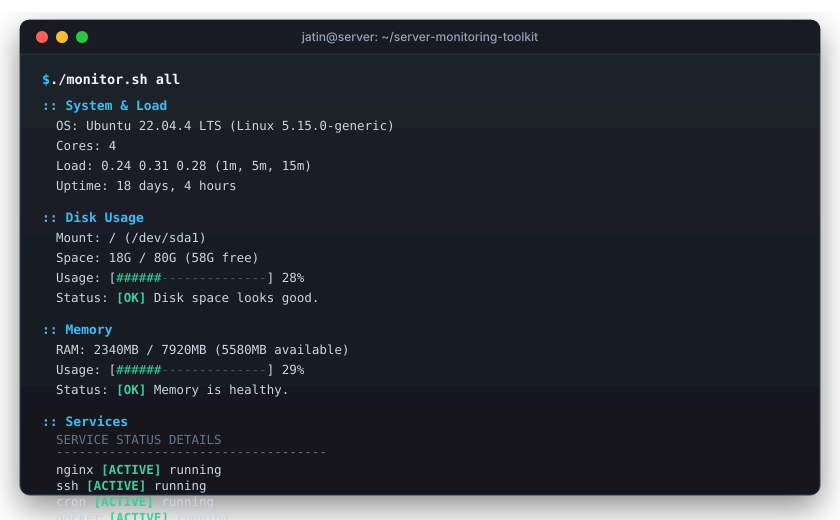

# server-monitoring-toolkit


A lightweight Bash & Web monitoring toolkit to check server health in one place. Instead of SSHing into a box and manually running `df -h`, `free -m`, `uptime`, and checking `systemctl` individually, this pulls the key metrics into a single view — available either in your terminal or via a local web dashboard.

It does more than read process status: HTTP and port checks confirm a service is actually answering, and every check exits with a standard status code, so it can run from cron, CI or a monitoring system.

Works on Linux (systemd / SysV) and macOS. Tested on both in CI.



## Quick Start

Make the script executable and run it:

```bash
chmod +x monitor.sh
./monitor.sh
```

Running `./monitor.sh` without arguments launches an interactive terminal menu:

```text
Server Health Monitor (v2.1)
Host: prod-web-01 | Date: 2026-09-13 02:00:15
--------------------------------------------------
Choose an option:
  1) Check disk usage
  2) Check memory (RAM)
  3) Check services
  4) Check CPU & system load
  5) Run all checks
  6) Watch mode (live refresh)
  7) Launch web dashboard
  8) Check a URL (HTTP health)
  q) Quit

Select [1-8, q]:
```

## CLI Usage

You can also bypass the menu and pass subcommands directly for scripts or quick checks:

```bash
./monitor.sh all                      # Run everything in one summary
./monitor.sh disk                     # Check root partition usage
./monitor.sh memory                   # Check RAM utilization
./monitor.sh services                 # Check nginx, ssh, cron, docker
./monitor.sh system                   # Check OS, CPU cores, load average, uptime
./monitor.sh http http://localhost/   # Check that a URL answers
./monitor.sh port 80 443 db:5432      # Check that ports are listening
./monitor.sh watch 2                  # Live terminal dashboard (refreshes every 2s)
```

### Example CLI Output

```text
:: System & Load
  OS:      Ubuntu 22.04 LTS
  Cores:   4
  Load:    0.35 0.42 0.38 (1m, 5m, 15m)
  Uptime:  14 days, 3 hours

:: Disk Usage
  Mount:   / (/dev/sda1)
  Space:   18G / 80G (58G free)
  Usage:   [#####---------------]  22%
  Status:  [OK] Disk space looks good.

:: Memory
  RAM:     2140MB / 7920MB (5780MB available)
  Usage:   [#####---------------]  27%
  Status:  [OK] Memory is healthy.

:: Services
  SERVICE        STATUS       DETAILS
  ------------------------------------
  nginx          [ACTIVE]     running
  ssh            [ACTIVE]     running
  cron           [ACTIVE]     running
  docker         [ACTIVE]     running

:: HTTP Health
  [DOWN]  -           -  http://localhost/ (connection refused)

Result: CRITICAL (exit 2)
```

## Health Checks: Running Is Not the Same as Serving

`systemctl` reporting `active (running)` only means the process is alive. nginx with an empty `sites-enabled/` directory starts cleanly, shows as active, and serves nothing (I hit exactly this in my [Linux server capstone](https://github.com/Janmayjay007/linux-devops-capstone)). A process check calls that healthy. These checks ask the service itself:

```bash
./monitor.sh http http://localhost/ https://example.com/health
./monitor.sh port 80 443 127.0.0.1:5432
```

| Result | Meaning |
|---|---|
| `[UP]` | Answered with 2xx/3xx |
| `[SLOW]` | Answered, but slower than `HTTP_SLOW_MS` (warning) |
| `[FAIL]` | Answered with 4xx/5xx (critical) |
| `[DOWN]` | No answer: connection refused, DNS failure or timeout (critical) |
| `[OPEN]` / `[CLOSED]` | Something is / nothing is listening on the port |

To include them in `all`, list them in environment variables:

```bash
CHECK_URLS="http://localhost/" CHECK_PORTS="80 443" ./monitor.sh all
```

## Exit Codes

Every command exits with a status that follows the Nagios plugin convention:

| Code | Status | Example |
|---|---|---|
| 0 | OK | Everything within thresholds |
| 1 | WARNING | Disk above `DISK_THRESHOLD`, slow HTTP answer |
| 2 | CRITICAL | Disk above `DISK_CRITICAL`, a stopped service, a URL that is down |
| 3 | UNKNOWN | A check could not run (bad argument, missing tool) |

When several checks run, the most severe result wins (CRITICAL > WARNING > UNKNOWN > OK), so a check that could not run never hides a real outage.

That makes it usable from cron, for example to alert only when something is wrong:

```bash
*/5 * * * * CHECK_URLS="http://localhost/" /opt/monitor/monitor.sh all > /tmp/health.log || mail -s "Server unhealthy" ops@example.com < /tmp/health.log
```

## Checking Custom Services

To check specific services instead of the defaults, pass them as arguments:

```bash
./monitor.sh services postgresql redis apache2
```

A stopped service is critical. A service you name that is not installed is also critical. The default list is a best guess (`ssh` vs `sshd`, `cron` vs `crond` differ between distros), so defaults that are not installed are only shown, not counted.

## Custom Thresholds

Thresholds can be adjusted with environment variables:

| Variable | Default | Meaning |
|---|---|---|
| `DISK_THRESHOLD` / `DISK_CRITICAL` | 85 / 95 | Disk usage % for warning / critical |
| `MEM_THRESHOLD` / `MEM_CRITICAL` | 85 / 95 | Memory usage % for warning / critical |
| `HTTP_TIMEOUT` | 5 | Seconds before a URL counts as down |
| `HTTP_SLOW_MS` | 2000 | Response time that counts as a warning |
| `CHECK_URLS` / `CHECK_PORTS` | (empty) | Extra checks that `all` runs |

```bash
# Warn if disk usage is above 90% or RAM is above 80%
DISK_THRESHOLD=90 MEM_THRESHOLD=80 ./monitor.sh all
```

## Web Dashboard

For visual monitoring in a browser, start the built-in web dashboard (requires Python 3, zero external packages):

```bash
./monitor.sh web              # http://127.0.0.1:8080
./monitor.sh web 3000         # Use custom port 3000
```

The web dashboard provides:
- Live gauges for CPU Load, RAM allocation, and Disk capacity.
- Real-time daemon status for background services (`nginx`, `ssh`, `cron`, `docker`).
- Top Running Processes table with interactive sorting by CPU and Memory usage.
- Auto-polling every 3 seconds with a live status indicator.

### Security

The dashboard has no login and shows your process list, so it listens on `127.0.0.1` only by default. To view it from your laptop, use an SSH tunnel instead of opening a port:

```bash
ssh -L 8080:127.0.0.1:8080 user@your-server   # then open http://localhost:8080
```

If you really need it on the network, pass a host (`./monitor.sh web 8080 0.0.0.0`); it prints a warning and should sit behind a firewall or a reverse proxy with authentication.

## Tests

The test suite uses [bats](https://github.com/bats-core/bats-core). It starts real local HTTP servers to check UP, FAIL, DOWN and SLOW results, the exit codes, and that the dashboard listens on localhost only.

```bash
bats tests
shellcheck monitor.sh tests/test_helper.bash
```

GitHub Actions runs shellcheck, then the tests on both Ubuntu and macOS, on every push and pull request.

## How It Works

- **Disk**: Uses `df -P /` so output doesn't wrap on long device names, parses used/free space, and draws a clean progress bar.
- **Memory**: Reads `/proc/meminfo` or `free` on Linux (accounting for buffers and cache). On macOS, it reads `vm_stat` and `sysctl` to calculate active vs available memory.
- **Services**: Uses `systemctl show -p LoadState` to tell "not installed" from "stopped", then `systemctl is-active`. Falls back to `service` (SysV) or process scanning (`pgrep`) if running inside a minimal container or macOS.
- **HTTP**: Uses `curl` with a timeout and reads the status code and response time; curl's exit code explains failures (refused, DNS, timeout).
- **Ports**: Uses `nc -z`, or bash's `/dev/tcp` when `nc` is not installed.
- **CPU / Load**: Parses `uptime` load averages and shows them next to the core count.
- **Web API**: Built-in HTTP server (`web/server.py`) serving static assets and exposing `/api/stats` as JSON.

## License

MIT
